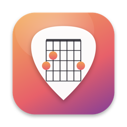
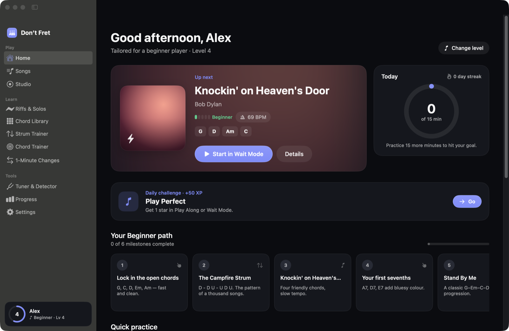
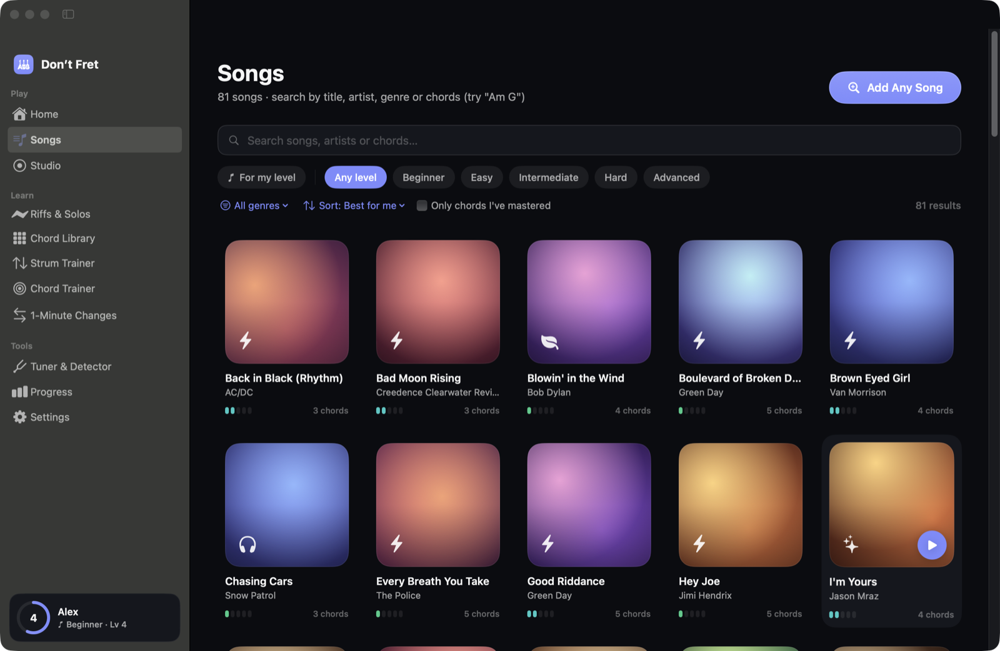
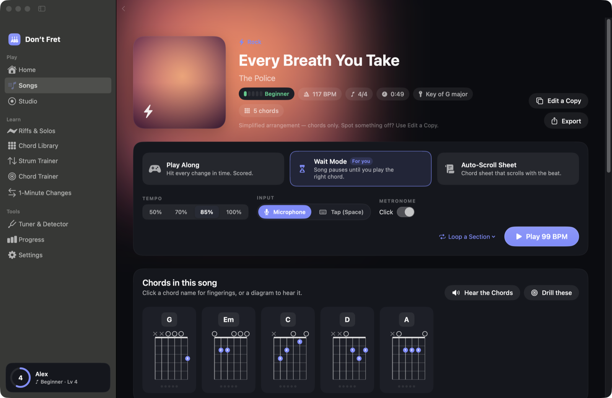
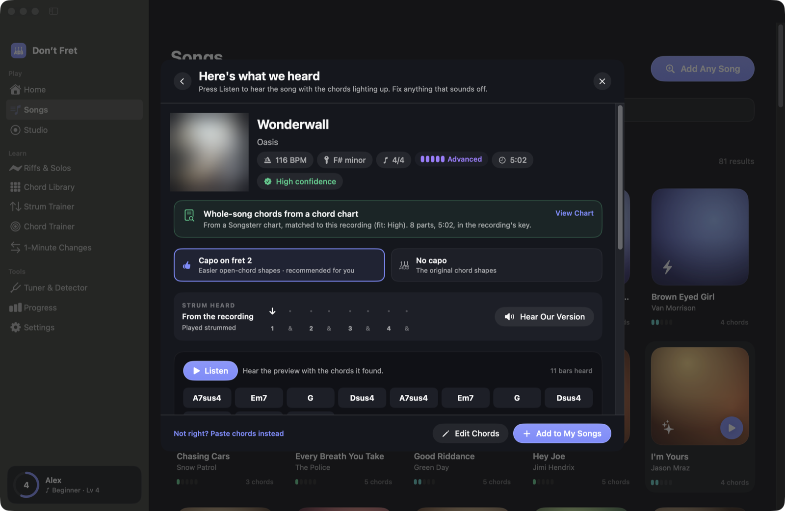
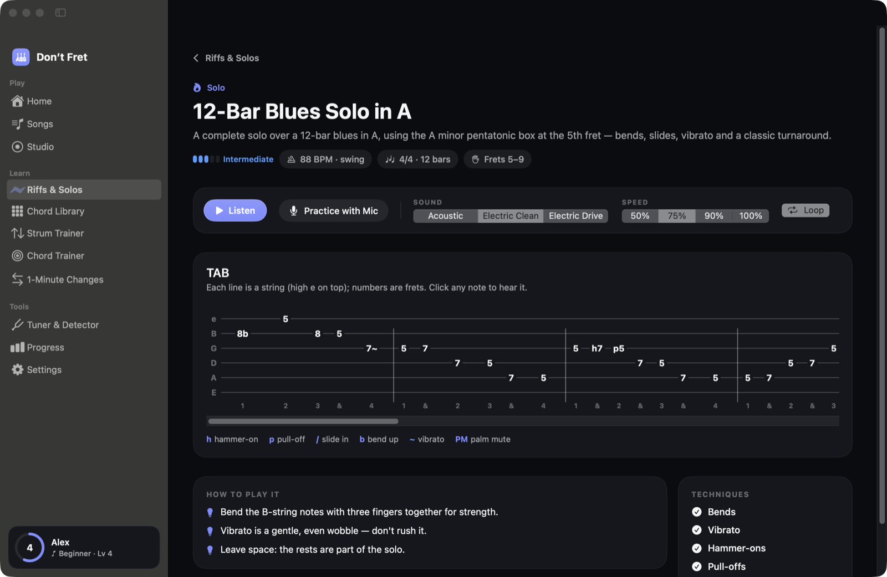
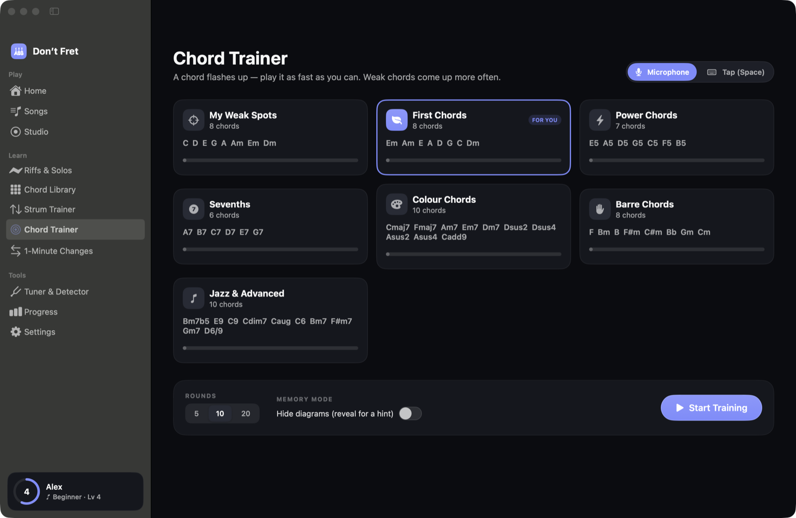
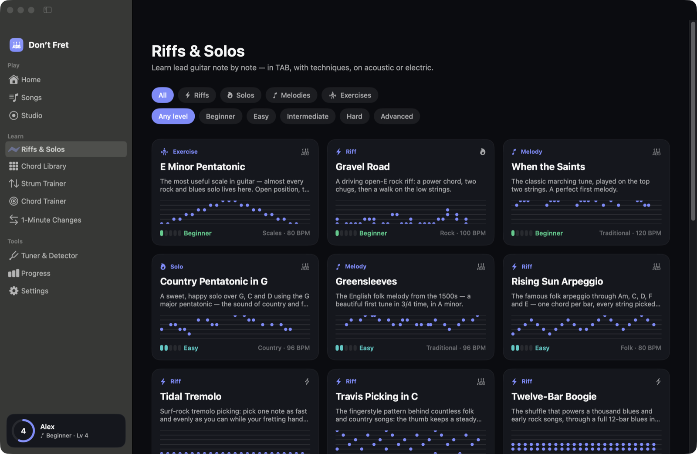
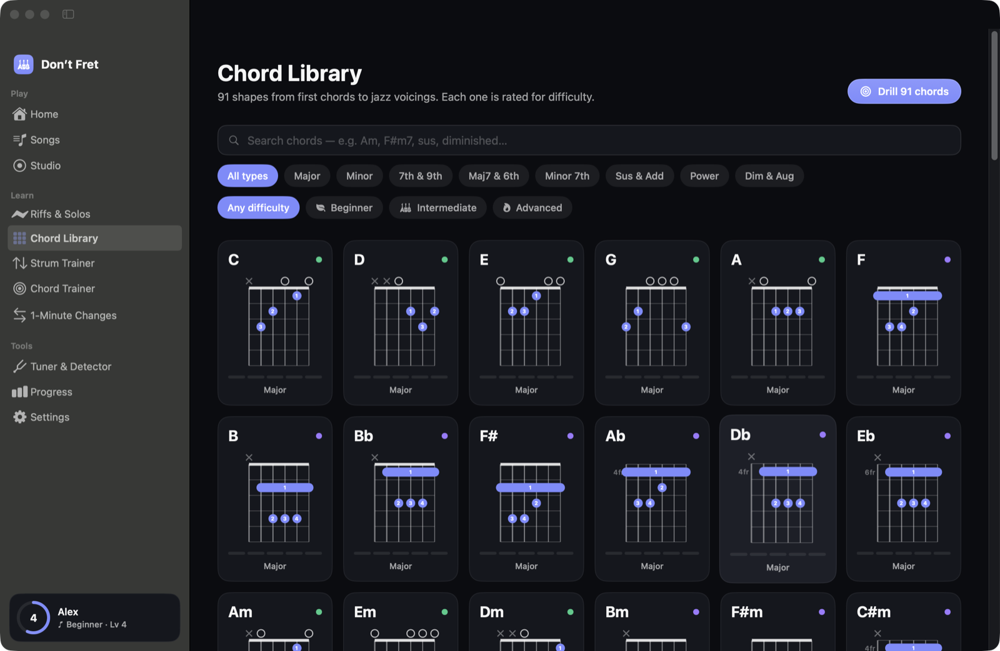

<div align="center">



# Don't Fret

**Learn guitar by playing real songs — on your Mac.**<br>
Don't Fret listens to your guitar through the microphone and tells you when you've got it right.

[](https://github.com/wmasse/dont-fret/releases/latest)




</div>

---

## What it does

<table>
<tr>
<td width="50%" valign="top">

### 🎸 Play real songs
80+ songs from Bob Dylan to Oasis, each rated for difficulty. Play along in time, use **Wait Mode** (the song waits until you play the right chord), or follow an auto-scrolling chord sheet. Loop the hard part and it speeds up as you get it.

</td>
<td width="50%" valign="top">



</td>
</tr>
<tr>
<td width="50%" valign="top">



</td>
<td width="50%" valign="top">

### 👂 Hear how it should sound
**Hear the Chords** plays the whole song with a realistic guitar: strummed, fingerpicked, boom-chick country, palm-muted power chords or reggae, at the song's own tempo. Change the key, add a capo, see every chord shape.

</td>
</tr>
<tr>
<td width="50%" valign="top">

### 🔎 Add any song
Search for any song and Don't Fret finds a chord chart for the **whole song** (verses, choruses, bridge), then listens to the recording to confirm the key, tempo, capo and strumming pattern. No chart? It works the chords out from the song's preview and tells you so. No account or key needed. You can also paste a chord chart or build a song chord by chord.

</td>
<td width="50%" valign="top">



</td>
</tr>
<tr>
<td width="50%" valign="top">



</td>
<td width="50%" valign="top">

### ⚡ Riffs & Solos
18 riffs, solos, melodies and exercises in TAB, from *When the Saints* to a 12-bar blues solo and a high-speed pentatonic run. Hear them on acoustic, clean electric or overdriven electric, slow them down, loop them, then play them back to the mic note by note.

</td>
</tr>
<tr>
<td width="50%" valign="top">

### 🎯 Build real skills
- **Chord Library:** 91 shapes from first chords to jazz voicings
- **Chord Trainer:** chords flash up and you play them; your weak ones come back more often
- **1-Minute Changes** and a **Strum Trainer** for rhythm
- **Tuner & chord detector**
- XP, levels, streaks, a daily challenge and a learning path for your level

</td>
<td width="50%" valign="top">



</td>
</tr>
<tr>
<td colspan="2" valign="top">

### 🎬 Studio
Record yourself playing, as audio only or as video with sound (any camera, including an iPhone through Continuity Camera). You can play along to a click or one of your songs. Then **trim** it, select any part to **cut it out**, keep only it or loop it, and **stack layers** on top (a second guitar, vocals, a solo) that you can mute, solo, pan, nudge, auto-align or re-record over just the bit you missed. Pick a sound preset (Warm, Live Room, Concert Hall, Radio Ready, Lo-Fi…) or adjust bass, treble, reverb, levelling and fades while you listen. **Export** a finished `.m4a`, `.wav` or `.mp4` that's ready to share.

</td>
</tr>
</table>

<div align="center">


</div>

## Download & install

1. Download **`DontFret-<version>.dmg`** from the [latest release](https://github.com/wmasse/dont-fret/releases/latest).
2. Open it and drag **Don't Fret** into **Applications**.
3. **The first time you open it**, macOS warns that it can't check the app, because it isn't from the App Store. To open it anyway:
   - **macOS 15 Sequoia and later:** open the app once, click **Done**, then go to **System Settings → Privacy & Security**, scroll down and click **Open Anyway**.
   - **macOS 14 Sonoma:** Control-click (or right-click) the app in Applications, choose **Open**, then click **Open**.
4. Allow **microphone** access so it can hear your guitar (and **camera** access if you record video in the Studio).

**Needs:** macOS 14 Sonoma or later and any guitar (acoustic or electric through an amp or audio interface). The built-in Mac microphone works fine.

> [!TIP]
> In a noisy room, run **Settings → Microphone & timing → Calibrate** first so the app learns what your guitar sounds like.

## Adding songs

**Songs → Add Any Song** (⌘N): type a song title or artist. The app finds it in Apple's public music catalog and downloads the 30-second preview. Because a preview is only part of the song, it also looks up a human-made chord chart on Songsterr and lines it up with the recording: the fit picks the real key (even for charts written for a capo), the tempo comes from the recording, and every verse, chorus and bridge is laid out to the song's real length. Only chord names are kept, never lyrics. If there's no chart, or the chart doesn't match the recording, the chords are worked out from the preview alone and the review screen says so.

Listen along with the chords lighting up, fix anything in the visual editor, or paste a chord chart from any website instead. You can also import ChordPro (`.cho`) or plain-text charts.

## Privacy

Everything stays on your Mac. There's no account, no tracking and no ads. Your progress is saved in `~/Library/Application Support/DontFret/`, and **Settings → Back Up** saves it to a file you can move to another Mac. Studio recordings are saved in the `Studio` folder there and never leave your Mac unless you export them. The app only goes online to fetch album covers for the built-in songs from Apple's public music catalog, and when you search for a song to add (Apple's catalog for the preview, Songsterr for a chord chart). No personal information is sent.

## Build it yourself

Only the Xcode Command Line Tools are needed. No Xcode project, no dependencies.

```bash
git clone https://github.com/wmasse/dont-fret.git
cd dont-fret
./build.sh
open "build/Don't Fret.app"
```

See **[docs/DEVELOPING.md](docs/DEVELOPING.md)** for how the code is organised, how songs and riffs are written, how releases are made, and the self-test that checks the chord detection.

---

<div align="center">
<sub>Built-in songs use simplified, beginner-friendly arrangements. Song titles belong to their artists; Don't Fret isn't affiliated with them or with Apple.</sub>
</div>
