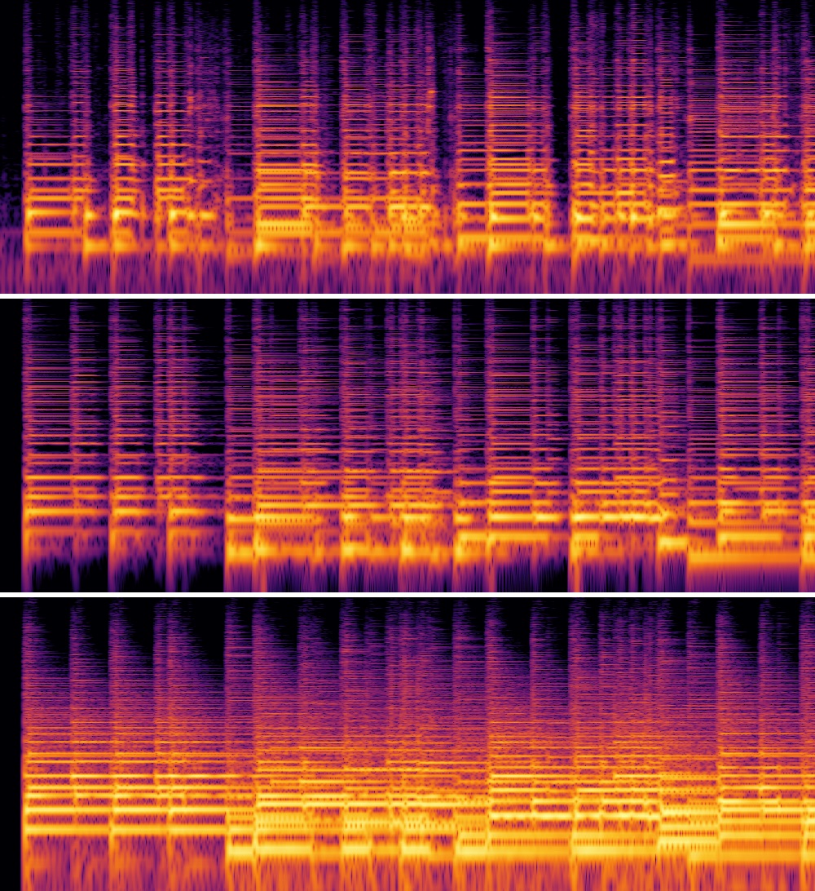

# Developing Don't Fret

Everything here builds with only the Xcode Command Line Tools (macOS 14+). No Xcode project, no dependencies.

## Build & run

```bash
./build.sh
open "build/Don't Fret.app"
```

To make a downloadable release (universal Apple Silicon + Intel app in a DMG):

```bash
scripts/release.sh 1.1
```

## What's inside

| Area | File |
|---|---|
| App shell, sidebar, onboarding, settings, themes | `Sources/App/DontFretApp.swift`, `RootView.swift`, `Theme.swift` |
| Chord theory, 90+ chord shapes, easy/alt voicings, voicing generator, transposing | `Sources/App/Music.swift` |
| 80+ songs/lessons (chords and single-note riffs), strum patterns, per-section strums | `Sources/App/Songs.swift` |
| ChordPro / plain-text import and export | `Sources/App/ChordPro.swift` |
| Mic chord & note detection, muted-string hints, YIN tuner, strum onsets & direction, input devices | `Sources/App/Audio.swift` |
| Guitar sound: strums, picking, fingerstyle, techniques (the musical API) | `Sources/App/Synth.swift` |
| Guitar engine: modal steel strings, sympathetic resonance, pickups, amp | `Sources/App/GuitarEngine.swift` |
| Guitar body, microphones and room (synthesized impulse responses, calibration) | `Sources/App/GuitarBody.swift` |
| DSP: partitioned convolution, filters, limiter, oversampling | `Sources/App/GuitarDSP.swift` |
| Sound lab: offline rendering and measurement against studio recordings | `Tests/SoundLab.swift`, `scripts/soundlab/` |
| Riffs & Solos: 18 riffs, solos, melodies and exercises with TAB, techniques, playback and mic practice | `Sources/App/Riffs.swift` |
| Studio: takes store, audio/video recorder, live mixer with effects, offline mixdown, video export | `Sources/App/StudioEngine.swift` |
| Studio pages: record panel, takes, editor with trim/layers/sound/export | `Sources/App/StudioView.swift` |
| Play Along / Wait Mode / Auto-Scroll sheet, section loops with auto speed-up | `Sources/App/Game.swift` |
| Chord Trainer (spaced review), 1-Minute Changes, Strum Trainer | `Sources/App/Practice.swift` |
| Song library, song page (key & capo, tricky changes, history), song editor | `Sources/App/SongsView.swift` |
| Melody from a recording: pitch tracking, notes on the song's beats, fret positions, the melody strip | `Sources/App/Melody.swift`, `MelodyView.swift` |
| Time-synced lyrics: LRCLIB lookup, lining up with the recording, karaoke display | `Sources/App/Lyrics.swift`, `LyricsView.swift` |
| Mic calibration, timing calibration, backup & restore | `Sources/App/Calibration.swift` |
| Tuner, progress, achievements | `Sources/App/TunerView.swift` |
| Progress, XP, skill levels, learning paths, achievements, daily challenge | `Sources/App/Store.swift` |

Progress is saved to `~/Library/Application Support/DontFret/progress.json`. **Settings → Back Up** writes the same data to any file — save it in iCloud Drive to move it between Macs.

Built-in songs use simplified, beginner-friendly progressions and aren't synced to recordings. Use **Edit a Copy** on any song to fix chords for your own version, or import a ChordPro chart.

## Songs and chord charts

**Songs → Add Any Song** (⌘N): search for any song by title or artist. The app finds it in Apple's public music catalog (no account needed), downloads the 30-second preview and album art, and works out the chords automatically:

1. Onset detection and a dynamic-programming beat tracker find the tempo and beats.
2. Beat-by-beat bass and treble pitch profiles go through a chord recognizer that knows the song's key and prefers chord changes on the downbeat.
3. It finds the repeating progression and suggests the capo position that gives the easiest shapes.

You can listen to the preview with the chords lighting up, fix chords in the visual editor, or paste a chord chart from any website instead. Every song page has **Hear the Chords** to play the chords in order at the song's tempo, in its playing style: strummed with the song's pattern, fingerpicked, bass-note-and-strum, palm-muted power chords or reggae chops. For searched songs the strum pattern is detected from the recording.

`Sources/App/Transcriber.swift` (analysis), `SongFinder.swift` (catalog search, media), `AddSongView.swift` (the flow), `ProgressionPlayer.swift` (playback).

### Melody

Every analysis also picks out the song's tune, usually the lead vocal (`MelodyExtractor` in `Sources/App/Melody.swift`):

1. A 46 ms spectrum every 10 ms. For stereo audio (previews, audio files and the whole-song listen all keep a side channel), each bin is weighted by how centred it is in the stereo picture, `(|M|² − |S|²) / (|M|² + |S|²)`, because lead vocals are usually mixed in the middle.
2. Harmonic-sum pitch salience over G2–D6 in fifth-of-a-semitone steps, favouring a singer's range and pitches whose own fundamental is present.
3. A Viterbi path through the salience with a voiced/unvoiced state: moving pitch costs in proportion to the size of the move, so it follows one voice.
4. Notes: the singer's own tuning offset is measured from the pitch track, then a note-level Viterbi assigns each stretch of singing to a semitone (staying on a note is free, changing costs, notes in the key are slightly preferred), so vibrato and a singer sitting between two pitches don't flicker. Short glides are folded into the note they slide to, dips in strength split repeated notes, weak notes whose pitch doesn't move at all are dropped (singers wobble; strummed accompaniment doesn't), a note moves down an octave when the octave below explains the sound almost as well, and a lone note an octave away from both neighbours is moved back next to them.
5. `Transcription.songZeroBeat` says which beat of the recording is song beat 0 (the first bar, the bar a repeating loop was rotated to, or minus the chart offset for a matched chord chart), so `MelodyExtractor.place` can snap notes onto the song's own beat grid (16ths). A short preview's melody repeats with its chords.

The melody is stored on the song (`Song.melody`, relative to the capo like single-note tokens) and follows transposing and capo changes. `ProgressionPlayer` plays it on a second instance of the guitar (`GuitarSynth.melody`) so the tune doesn't cut off the chord's strings; `MelodyExtractor.picks` chooses where to fret each note (a small Viterbi over string/fret choices), hammer-ons and pull-offs for notes that carry straight on along a string, and vibrato on long notes. The song page shows it as a scrolling strip with string and fret labels that follows playback.

### Lyrics

Searched songs get time-synced lyrics from [LRCLIB](https://lrclib.net) (`Sources/App/Lyrics.swift`): a free, open lyrics database whose public API needs no account or key. Only the title, artist and track length are sent, with a `User-Agent` naming the app as LRCLIB asks, and a `Retry-After` is honoured. The exact `/api/get` lookup is tried first, then `/api/search` on title and artist for a release whose length is within 5 s.

LRC times are seconds into the full track, so the app has to work out where its recording starts in the track before it can use them:

1. `Lyrics.align` correlates when the melody finder heard a voice with when the lyrics say someone is singing, at every possible start (0.1 s steps). The melody finder also picks up guitar lines, so the voice is read two ways (any note with breaths filled in, and notes weighted by strength) and the start is only trusted when both agree and the best start stands out, or when every near-equal start would show the same words (a repeated chorus).
2. A whole-song recording (listened to or from a file) is taken to start with the song if the match isn't clear. A 30-second preview that can't be placed gets no lyrics, so it never shows the wrong ones. On the bench songs (`build/selftest --lyrics-bench`) LRCLIB has synced lyrics for 17 of 17, and about 5 of 17 previews can be placed confidently.
3. `Lyrics.place` puts each line on the song's beat timeline the same way the melody is placed: `MelodyExtractor.beatPosition` of the line's time in the recording, minus `Transcription.songZeroBeat`. A preview's lines repeat with its chords, like the melody.

The lines are stored on the song (`Song.lyrics`, beats, so they follow tempo changes) and shown karaoke-style: the words fill in as the line goes by (`KaraokeLines` in `LyricsView.swift`). On the song page a bar appears at the bottom while any Hear button plays, and a Lyrics card lists every line. Play Along shows the current line above the strum, and Auto-Scroll writes each line under the chord it starts on.

You can also build a song chord by chord, import ChordPro `.cho` / plain-text charts, or add a line to `SongCatalog.songs` in `Songs.swift`:

```swift
s("Title", "Artist", "Rock", bpm: 100, strum: "D-DU-UDU", [("Verse", "G D Em C", 2), ("Chorus", "C G D:2 D:2", 1)]),
```

Each chord fills one bar unless you write `Chord:beats` (half beats allowed, e.g. `G:1.5`). Write `~E3` for a single note, and in the editor `Chorus x2 [DUDUDUDU]: C G` sets a section's repeats and strum. Difficulty is rated automatically.

## Riffs & Solos

Each riff is written in a compact TAB shorthand in `RiffLibrary` (`Sources/App/Riffs.swift`):

```
E0+A2:1 E0m E0m E3 | G7h G5p B8b:1 e12~:2 r:1 D7/
```

A token is the string (`E A D G B e`), the fret, an optional technique (`h` hammer-on, `p` pull-off, `/` slide in, `b` bend a whole step, `~` vibrato, `m` palm mute), then an optional `:beats` and `*repeat`. `+` plays notes together, `r` is a rest, `|` is only there to make it readable. **Practice with Mic** turns the riff into a song whose notes carry their TAB position (`~G4@B8`).

## Studio

- **Storage:** takes live in `~/Library/Application Support/DontFret/Studio/`. `takes.json` holds every `Take`: its recording, an audio file the mixer can read (for video, the sound is extracted to `<id>-sound.m4a`), its `TakeEdit` and its overdub layers. `StudioStore(folder:)` can point anywhere, which tests use.
- **Recording:** `StudioRecorder` uses `AVCaptureSession` with `AVCaptureAudioFileOutput` (AAC `.m4a`) or `AVCaptureMovieFileOutput` (`.mov`). The camera needs `NSCameraUsageDescription`, which `build.sh` writes.
- **Mixing:** `StudioGraph` routes the take and its layers through a mixer, then a 2-band EQ, an Apple dynamics processor ("even out the volume") and reverb. `StudioPlayback` runs it live and keeps a video `AVPlayer` in sync with `setRate(_:time:atHostTime:)`. `StudioRenderer.render` runs the same graph offline, then applies fades and levels the peak to −1 dB. `exportVideo` combines the trimmed picture (with opacity fades) and the mixed sound into an `.mp4`.
- **Layer alignment:** a layer's `start` is the take time of its first sample, worked out from the gap between the recorder starting and playback starting. Users can drag a layer to fine-tune it.
- **Cuts (clipping):** edits are non-destructive. `TakeEdit.cuts` lists removed ranges in take time and applies to every track. `Take.kept` is the trim window minus the cuts, `length` is their total, and `outputTime(_:)` / `takeTime(_:)` convert between the edited timeline and the original recording. `Take.cut` merges overlapping cuts and `keepOnly` cuts everything outside a range. Playback schedules only `kept` (the video plays a composition of the kept ranges), and both renderers do the same, with 6 ms ramps at each join to avoid clicks.
- **Layers:** an `Overdub` also has `pan`, `muted` and `inPoint` / `outPoint` (a trim inside the layer file; `used` is the part that plays, in take time). `StudioPlayback.solo` is a set of track ids (`"main"` or a layer id); when it isn't empty, only those play. Recording over a selection starts playback 2 s early in raw mode (ignoring cuts) and crops the new layer to the selection.
- **Auto-align:** `StudioMedia.align` compares onset envelopes (5 ms hop) of the layer and the main take and searches ±0.15 s for the best match. It moves the layer only when the peak is clearly above the rest (z-score > 2), otherwise it reports no match.
- **Undo:** `TakeEditorView` keeps a history of `Take` values; slider drags made in quick succession count as one step.

## Guitar sound

The guitar is synthesized, not sampled, so it can play any chord, voicing, capo position, fingerpicking pattern, bend or slide with no audio files in the app. Every constant below was measured from, or fitted to, professional studio recordings (see the sound lab below).

**Signal chain.** `GuitarSynth` (`Synth.swift`) turns musical requests into string events the way hands would: strings ~7 ms apart in a strum (the median measured from GuitarSet's players), the fretting hand muting strings that aren't in the chord or stopping ones whose fret changed, up-strums catching the top 3–5 strings, a tiny per-string tuning spread in chords. `GuitarCore` (`GuitarEngine.swift`) renders them in 256-sample blocks: six modal strings → bridge → one stereo convolution (body + microphones + room for the acoustic; pickups → amp → cabinet + room for the electrics) → a look-ahead limiter. Nothing allocates on the audio thread.

**Strings** (`ModalString`). Each string is a bank of resonators, one per partial (up to 16 kHz) and per polarization, run with SIMD:
- Inharmonicity: partial *k* is at *k·f0·√(1 + B·k²)*, with *B* per string measured from isolated GuitarSet notes (2–8 × 10⁻⁵). Fundamentals are lowered slightly (`tunerCompensation`) so a tuner reads each note exactly, as on a guitar tuned with a tuner.
- Decay: each partial loses *base + slope·f(kHz)* dB/s, per string, from the same measurements (~10 + 7·f dB/s). The vertical polarization drains faster than the horizontal, more so near the body's resonances (`bridgeMobility`) and at high frequencies, which gives a real string's punchy start and long, softly beating tail. The polarizations are split by a fraction of a hertz that varies per partial, so partials never beat in lock-step.
- Pluck: the bridge force of a string released at point β (amplitudes ∝ sin(kπβ)/k) through the softness of the touch: `.pick`, `.finger` (fingertip with a little nail) or `.thumb`, brighter when harder. A hard pluck starts ~2 cents sharp and settles (tension modulation). Pick, finger and chuck noises are short shaped bursts.
- Palm mutes and finger stops are extra, frequency-dependent loss. A chuck excites dead, muted strings. Free strings pick up the bridge motion of the others (sympathetic resonance).

**Body, mics, room** (`GuitarBody.swift`, built at launch in the background, cached). A modal dreadnought: measured low modes (air A0 ≈ 100 Hz, top ≈ 190–200 Hz, back ≈ 235 Hz, plate modes to 1 kHz) plus statistically drawn dense modes above 1 kHz, heard by two "microphones" (12th fret and lower bout) for a mono-compatible stereo image, then early reflections and a smooth tail (~1.3 s in the mids). A minimum-phase 1/3-octave curve, `acousticCalibration`, makes the whole chain match the long-term spectrum of the studio recordings; `acousticPolish` adds a light mix EQ on top (low cut, a little less box, a little air). The electric tones use a speaker-cabinet response and a smaller room instead.

**Levels.** About −17 LUFS for the acoustic, −15 LUFS for the electrics, matched to the previous engine so the app's volume is unchanged. The acoustic isn't compressed: it keeps a real recording's dynamics (peaks ~15 dB above the average, like the studio takes) and only the limiter trims the first milliseconds of the loudest strums.

### Sound lab

`Tests/SoundLab.swift` and `scripts/soundlab/` measure the guitar against real recordings. Reference: [GuitarSet](https://zenodo.org/records/3371780) (Xi, Bittner, Pauwels, Ye, Bello, ISMIR 2018; CC BY 4.0): 360 excerpts by six guitarists, five styles, strummed and picked, recorded with a Neumann U-87 and annotated note by note. Download `audio_mono-mic.zip` and `annotation.zip` (≈700 MB) and unzip each into its own folder.

```bash
# fast renderer (engine files only, ~10 s to build)
swiftc -O -parse-as-library Sources/App/GuitarDSP.swift Sources/App/GuitarBody.swift Sources/App/GuitarEngine.swift scripts/soundlab/RenderEvents.swift -o build/render-events
# measure the real guitars: strum timing, inharmonicity, partial decay, attack, long-term spectrum
python3 -I scripts/soundlab/measure.py <annotation dir> <mic dir>
# re-synthesize 20 performances note for note and score them (add --legacy <renderer> to compare another build)
python3 -I scripts/soundlab/resynth.py --ann <annotation dir> --mic <mic dir> --render build/render-events --out build/soundlab
# fit the calibration curve (measure without the mix polish), then paste it into GuitarBody.acousticCalibration
python3 -I scripts/soundlab/resynth.py ... --polish 0 --calibrate
# demo recordings of every playing style, plus their event lists
build/selftest --demos build/demos
```

`resynth.py` aligns each re-synthesis to its recording (GuitarSet's onsets sit ~9 ms after the sound reaches the mic) and reports, lower being closer to real: log-mel spectral distance (`lsd`), long-term spectrum error (`ltas`), loudness-envelope error per octave (`env`), brightness relative to real (`cent`, attack = first 30 ms), and decay per octave band. It writes spectrograms (real / new / old) and the audio. `RenderEvents` takes `--room`, `--polish`, `--cal` and `--set name=value` (the `GuitarTuning` knobs) so settings can be swept without rebuilding the app.

Current scores on the 20-clip set (old = the previous Karplus–Strong engine):

| | lsd | ltas | env | brightness | decay 1–8 kHz vs real |
|---|---|---|---|---|---|
| New | 12.3 dB | 4.2 dB | 10.1 dB | 1.05× | within 1–6 dB/s |
| Old | 13.8 dB | 7.4 dB | 10.0 dB | 0.41× | up to 2× off |

Known gap: attacks are ~1.3× brighter than the recordings relative to their sustain.



*8 s of singer-songwriter strumming from GuitarSet (player 03, CC BY 4.0), 40 Hz–16 kHz on a log scale: the U-87 recording (top), the new engine re-synthesizing the same notes (middle), the previous engine (bottom).*

## Detection self-test

```bash
swiftc -D SELFTEST -parse-as-library -swift-version 5 -O Sources/App/*.swift Tests/*.swift -o build/selftest && build/selftest
```

The test synthesizes every chord shape and single note and runs them through the recognizer. Current results:
- 97% of beginner chords and 87% of all chords are named correctly from scratch.
- In-game verification accepts 100% of correctly played chords; a wrong chord is accepted 3% of the time.
- Single notes (riffs): 100% accepted with pitch tracking, 0% wrong notes accepted.
- Muted-string hints catch 100% of detectable muted strings with no false alarms.
- Generated voicings, transposing, ChordPro round trip and catalog chords are all checked.

- Automatic chords from a full band mix (10 synthesized songs with guitar, bass, drums and melody): tempo, key and time signature 100%, bars 92%, whole progression 100%.
- Melody from a full band mix (8 synthesized 40 s songs with a sung-style lead over wide strummed guitars, bass and drums; `build/selftest --melody`): pitch right about 90% of the time the voice sings, notes about 70% F-measure (right pitch, onset within 100 ms), about 67% placed on the right beat. A quiet voice under loud guitars is the hard case (40–60%).
- Melody on real recordings (`build/selftest --melody-bench`, add `--verbose` for every note): 13 store previews of public-domain tunes we know note for note (*Silent Night*, *Amazing Grace*, *Jingle Bells*, *Joy to the World*, *Deck the Halls*, *When the Saints*, *Twinkle Twinkle*, *Happy Birthday*, *We Wish You a Merry Christmas*) sung by Bing Crosby, Kelly Clarkson, Elvis, Judy Collins, Michael Bublé, Sinatra, Nat King Cole, Louis Armstrong, Mariah Carey and children's recordings. The extracted melody is aligned to the written tune in any key and tempo, and each difference is classified. Currently 68% of the written notes come out right (octave slips 6%, a semitone off 5%, a tone off 6%, other wrong 8%, missed 7%); 28% of the heard notes aren't in the written tune, mostly backing vocals, horn and band fills, and singers' ornaments. Swing and gospel arrangements where the band answers the singer (Sinatra, Elvis) are the hard cases (30–50%). Previews download once into `build/bench` (needs the network).
- Guitar sound: every note from E2 to E5 within 4.4 cents (1.9 average) by the app's own tuner; bends, slides and hammer-ons within 3 cents; no clipping; partitioned convolution matches direct convolution; stereo correlation ≈ 0.6; thumb < finger < pick brightness; sympathetic resonance stays stable; the slowest 256-sample block takes ~2 ms of its 5.8 ms.

These numbers come from synthesized sound. A real guitar in a real room will differ, so run **Settings → Microphone & timing → Calibrate** first.
